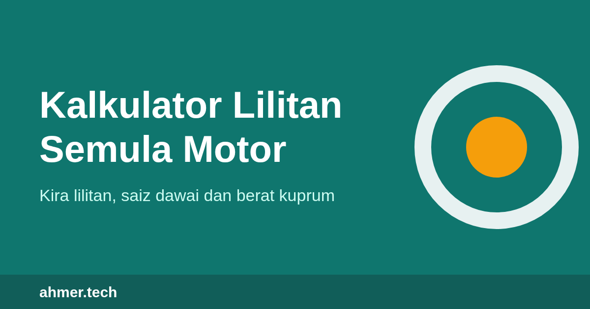

# Ahmer Tech: Kalkulator Lilitan Semula Motor

Repositori ini mengandungi fail laman web [ahmer.tech](https://ahmer.tech/), iaitu laman rujukan teknikal dalam bahasa Melayu tentang lilitan semula motor elektrik. Laman ini menyediakan kalkulator percuma, formula dan panduan bengkel untuk juruteknik, pelajar kejuruteraan elektrik dan sesiapa sahaja yang ingin memahami cara belitan motor dikira.

**Laman:** https://ahmer.tech/

## Kandungan laman

### Kalkulator

| Alat | Kegunaan |
|---|---|
| Belitan 3 fasa | Anggaran lilitan per gegelung, saiz dawai, faktor isian, berat kuprum dan rintangan fasa bagi stator motor aruhan tiga fasa |
| Dawai setara | Menggantikan satu saiz dawai dengan beberapa dawai selari yang jumlah luas keratannya hampir sama |
| Tukar voltan | Lilitan dan saiz dawai baharu apabila voltan atau frekuensi bekalan berubah |
| Panjang dan berat | Anggaran jumlah panjang dan berat dawai kuprum yang perlu dibeli |
| Pengubah | Lilitan per volt, lilitan primer dan sekunder serta saiz dawai bagi pengubah kecil satu fasa |

Formula di sebalik setiap kiraan dipaparkan di laman utama dan dihuraikan dalam artikel berkaitan.

### Artikel

Terdapat 35 artikel dalam lapan kategori. Setiap artikel mempunyai rajah dan pautan rujukan.

| Kategori | Bilangan artikel |
|---|---|
| Asas motor | 4 |
| Pengiraan belitan | 7 |
| Dawai dan penebat | 7 |
| Panduan bengkel | 7 |
| Ujian dan diagnosis | 3 |
| Motor satu fasa | 3 |
| Kos dan kecekapan | 2 |
| Rujukan | 2 |

## Struktur repositori

Laman ini statik sepenuhnya: HTML, CSS dan JavaScript biasa, tanpa rangka kerja atau pustaka luar. Semua fail berada di akar repositori.

| Fail | Keterangan |
|---|---|
| `index.html` | Laman utama: kalkulator, formula, senarai artikel dan soalan lazim |
| Fail `.html` yang lain | 35 halaman artikel serta halaman Tentang Kami, Hubungi Kami, Dasar Privasi dan Penafian |
| `404.html` | Halaman yang dipaparkan apabila alamat tidak ditemui |
| `gaya.css` | Helaian gaya |
| `kalkulator.js` | Enjin kiraan kalkulator |
| `laman.js` | Menu navigasi |
| `iklan.js` | Pemuat slot iklan; tidak aktif sehingga ID penerbit ditetapkan |
| `rajah-*.svg` | Rajah bagi setiap artikel |
| `logo.svg`, `ikon.png`, `kongsi.png` | Logo, ikon dan imej perkongsian |
| `sitemap.xml`, `robots.txt` | Fail untuk enjin carian |
| `google*.html` | Fail pengesahan Google Search Console; jangan dipadam |
| `CNAME` | Domain tersuai untuk GitHub Pages |

## Penerbitan

Laman ini dihoskan di GitHub Pages daripada cabang `main`. Setiap perubahan pada cabang ini diterbitkan secara automatik ke https://ahmer.tech/ dalam beberapa minit.

## Penafian

Keputusan kalkulator ialah anggaran reka bentuk. Ia tidak menggantikan data pengilang, belitan asal motor atau pertimbangan orang yang kompeten. Sila baca [penafian penuh](https://ahmer.tech/penafian.html) sebelum menggunakan mana-mana angka untuk kerja sebenar.

## Hubungi

Pembetulan, cadangan topik dan soalan dialu-alukan melalui halaman [Hubungi Kami](https://ahmer.tech/hubungi.html).

## Hak cipta

© 2026 Ahmer Tech. Hak cipta terpelihara.

